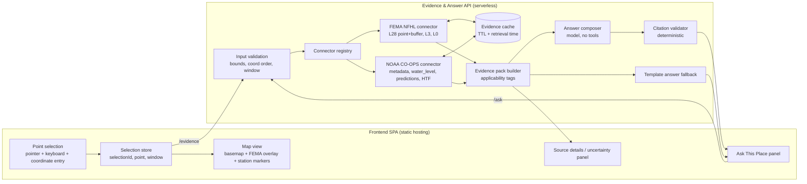

# Technical design — Florida Explorer

Status: technical design for owner review (G1). **Implementation NOT authorized**; every build step below is pending Chuck's explicit approval (G2). Diagrams are illustrative.

Related: [source-feasibility.md](source-feasibility.md) · [analyzer-reuse-findings.md](analyzer-reuse-findings.md) · [evidence-and-agent-design.md](evidence-and-agent-design.md) · [validation-plan.md](validation-plan.md) · [cost-security-and-decisions.md](cost-security-and-decisions.md) · [implementation-proposal.md](implementation-proposal.md)

## 1. Summary of recommendation

- **Shape:** static single-page frontend + thin serverless **Evidence & Answer API**. The browser never holds model credentials and never talks to the model provider directly.
- **Evidence first, model second:** connectors retrieve FEMA/NOAA records deterministically for the selected point *before* any model call. The model receives a frozen evidence pack, has **no tools**, and must return structured claims that cite evidence IDs. A deterministic validator accepts, downgrades or drops each claim. A no-model template answer is always available as fallback.
- **Map:** ArcGIS Maps SDK for JavaScript (`@arcgis/core` 5.x) recommended (option M2), with MapLibre + `@esri/maplibre-arcgis` (M1) as the close alternative — owner decision D1.
- **NOAA:** station-first presentation (station markers + context panel with the values the explanation used). Spatial NOAA overlay deferred (D3).
- **Stack (proposed, not installed):** TypeScript end to end; React + Vite frontend (matches the analyzer and Chuck's existing skills); backend as serverless functions on a provider chosen in D4.

## 2. Architecture options

| Option | Description | Pros | Cons | Verdict |
|---|---|---|---|---|
| A. Static SPA only | Browser calls FEMA/NOAA and the model directly (analyzer pattern) | Simplest hosting, free Pages | Model key exposed (any `VITE_*` value is public); no server-side citation validation; CORS/504 handling in browser; no evidence archive | **Reject** |
| B. SPA + serverless Evidence & Answer API | Browser → API → connectors + model; validator server-side | Secrets server-side; deterministic validation; caching; small ops footprint; pay-per-use | Two deploy targets; cold starts | **Recommend** |
| C. ArcGIS Online / Experience Builder app + custom widget | Low-code Esri app | Fast map UI, Esri hosting | Agent, validator and evidence store still need a backend; harder to test/trace; licensing tied to ArcGIS Online org | Reject for MVP |
| D. Long-running server (container) | Node service on a VM/container platform | Full control, warm caches | Always-on cost and patching for a low-traffic MVP | Keep as fallback if serverless limits bite |

## 3. Mapping option comparison (PRD "Mapping design decision")

| Criterion | M1 MapLibre GL 6.x + `@esri/maplibre-arcgis` | M2 ArcGIS Maps SDK for JS 5.x |
|---|---|---|
| Matches charter wording "ArcGIS map" | Partly (ArcGIS basemaps/services in an open renderer) | Yes |
| License | BSD-3 / Apache-2.0 | Esri proprietary terms (registry: "SEE LICENSE IN LICENSE.md"); use requires ArcGIS account/API key — terms Unverified |
| NFHL MapServer rendering | Must build `export` raster URL or query GeoJSON (analyzer approach caps at 1000 features, generalized) | Native `MapImageLayer`/`FeatureLayer`; server renders zones at service scale; legend from service |
| CRS handling (NFHL 4269, SLR 3857) | Manual | Built-in projection engine |
| Keyboard map navigation | Arrow/zoom keys built in; point selection custom | Keyboard navigation built in; point selection custom |
| Bundle size | Small | Large (lazy-loadable) |
| Analyzer pattern continuity | High (but code copy needs D7 permission anyway) | Patterns translate; no code reuse |
| Future domains (FNAI, county GIS — mostly ArcGIS REST) | Each service needs adapter code | Native consumption of ArcGIS REST services |

**Recommendation: M2**, because the product is explicitly an ArcGIS map, nearly every candidate Florida source is ArcGIS REST, and native MapServer rendering avoids the generalization/cap problems found in the analyzer. Choose **M1** instead if Chuck prefers open-source licensing or Esri free-tier terms prove unsuitable. Both are equal on the requirement that **classification comes from the server-side point query, not from the rendered map**.

## 4. Component boundaries

| Component | Responsibility | Must not |
|---|---|---|
| Point selection | Click/tap; keyboard: crosshair at map centre + "Select centre point" (Enter); typed lat/lon entry with validation; displays WGS84 to 5 dp | Infer a location from IP/geolocation without user action |
| Selection store | Monotonic `selectionId`, point, active layers, question window; aborts in-flight requests on change | Let a response with an old `selectionId` render |
| Connector registry | Declarative records per source (endpoint, fields, terms URL, attribution, TTL, verification date) — the S01–S08 registry made executable | Hold credentials for public sources |
| FEMA connector | Classification state machine (source-feasibility.md §S01 rules) | Use rendered tiles or envelope queries for classification |
| NOAA connector | Curated station table, metadata, observation/prediction/HTF requests ≤ product range limits | Pick nearest station silently; transfer thresholds to the point |
| Evidence pack builder | Normalizes records to the evidence contract, assigns `E#` ids, computes applicability (spatial, temporal, class) and allowed-claim types | Pass raw source HTML/text as instructions |
| Answer composer | One model call with system policy + JSON evidence pack + question → structured claims | Call tools, fetch URLs, see secrets |
| Citation validator | Per-claim checks (evidence-and-agent-design.md §4) | Let an unvalidated claim through |
| Template fallback | Deterministic summary from evidence pack when model unavailable/invalid | Pretend to be a model answer |

## 5. Request flow

1. User selects point → frontend validates bounds, increments `selectionId`, aborts previous requests, renders marker + coordinates.
2. `POST /evidence {selectionId, lat, lon, window?}` → API validates, runs FEMA and NOAA connectors in parallel (8 s timeout each, one retry on 5xx/504), returns evidence pack + per-source status. Frontend renders FEMA zone card, NOAA station card(s), partial/failed states.
3. User asks a question → `POST /ask {selectionId, lat, lon, window, question, evidencePackId}`. API re-binds to the stored pack for exactly that point/window (or rebuilds), calls the model, validates claims, returns `{selectionId, locationEcho, findings[], citations[], unavailableSources[], limitations[]}`.
4. Frontend renders only if `selectionId` and `locationEcho` match the current selection; otherwise discards (AC05).
5. Follow-up questions reuse the current point; changing the point clears the conversation context or shows "now asking about new point" explicitly.

## 6. Deployment options (all pending D4; nothing deployed)

| Option | Frontend | API | Secrets | Notes |
|---|---|---|---|---|
| D4-a | GitHub Pages | Cloudflare Workers | Worker secrets | Free tiers generous; edge cache API; cold start minimal |
| D4-b | Vercel/Netlify static | Same platform functions | Platform env vars | One platform, simple previews |
| D4-c | GitHub Pages | AWS Lambda + API Gateway | AWS Secrets Manager/SSM | Most control; most setup |
| D4-d | Azure Static Web Apps | Integrated Functions | App settings / Key Vault | Good if Chuck prefers Azure |

Recommendation: **D4-a or D4-b**, chosen on Chuck's existing accounts. Requirements regardless of host: secrets server-side only; CORS restricted to the frontend origin; per-IP rate limit on `/ask`; structured logs without full coordinates or question text (cost-security doc).

## 7. Domain extension strategy

- Domains are **connector packs** + **evidence classes** + **claim policies**; no domain-specific code in the composer.
- Each connector registers: evidence classes it can emit, spatial semantics (point-in-polygon, nearest-station, grid cell such as FNAI 1-sq-mi units), precision, and allowed claim types (e.g., FNAI: "Documented / Documented-Historic / Likely / Potential occurrence in this matrix unit" — never density or confirmed sighting).
- The validator is driven by those declarations, so adding Nature & Wildlife adds rules ("no density from sightings", "sensitive coordinates generalized") without changing the flood path.
- Geographic expansion beyond Florida: bounds and curated station tables are data, not code.

## 8. Changes recommended to the baseline (not applied)

| # | Recommendation | Reason |
|---|---|---|
| C1 | Add an NFHL coverage check (layer 0) and FIRM effective date (layer 3) to R02 wording | Layer 28 alone cannot distinguish no-zone from no-coverage and lacks effective date (verified) |
| C2 | State in R03 that MVP NOAA presentation is station-first; overlay is a later increment | SLR point identify unusable at point scale (verified) |
| C3 | Add "classified near boundary" as an explicit R02/AC02 state with an approved buffer distance | Two zones within 30 m of the Briny Breezes internal point (verified) |
| C4 | Add a typed-coordinate entry to R01's keyboard equivalent | Gives exact, testable AC01/AC11 input |
| C5 | Clarify in the PRD that "ArcGIS map" means ArcGIS SDK *or* ArcGIS basemaps/services | Needed to decide D1 |
| C6 | Update README/decisions log once Chuck accepts or rejects this design | README still says "Devin handoff NOT sent" |
