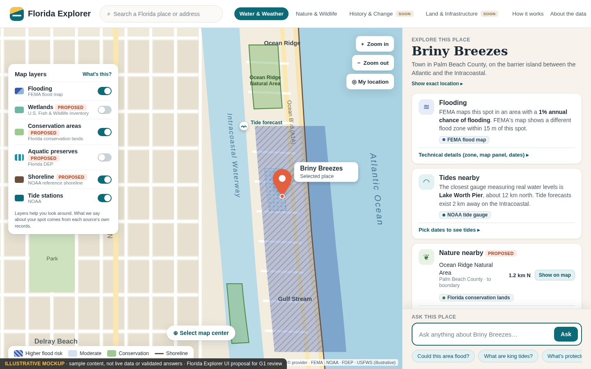
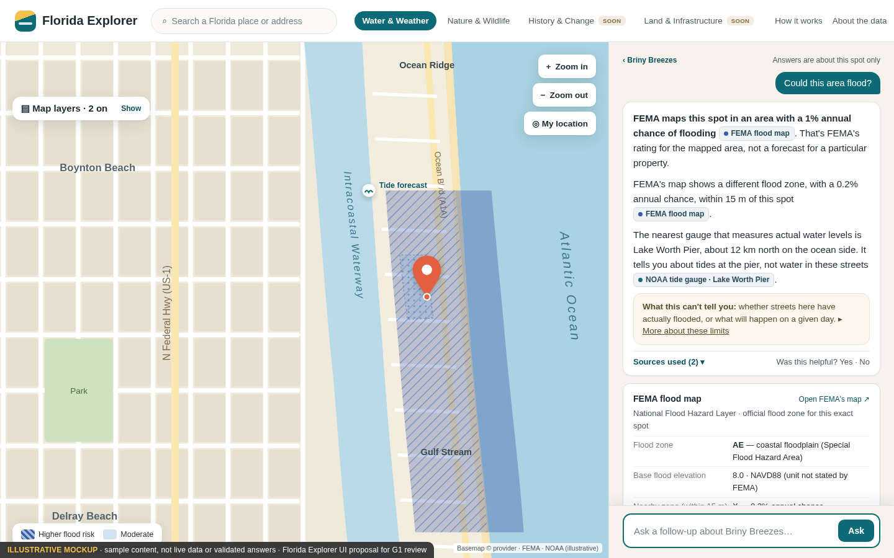
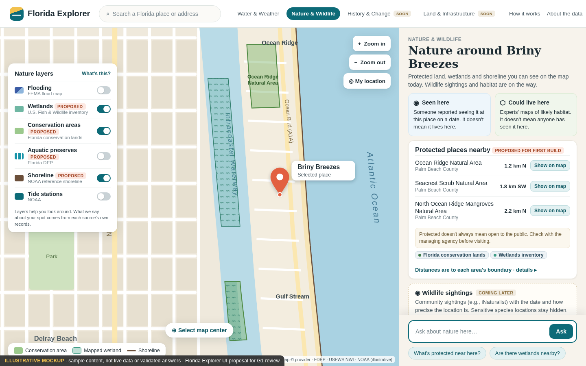
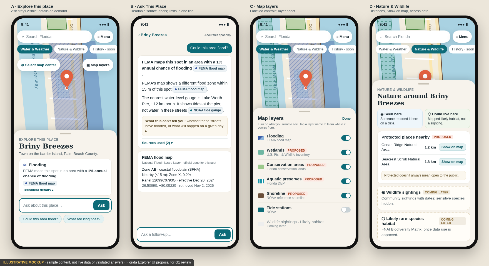
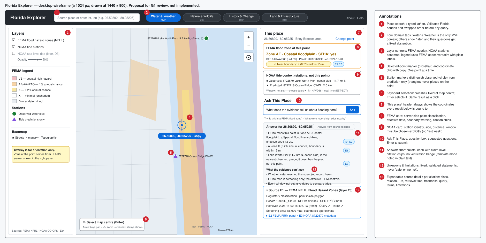
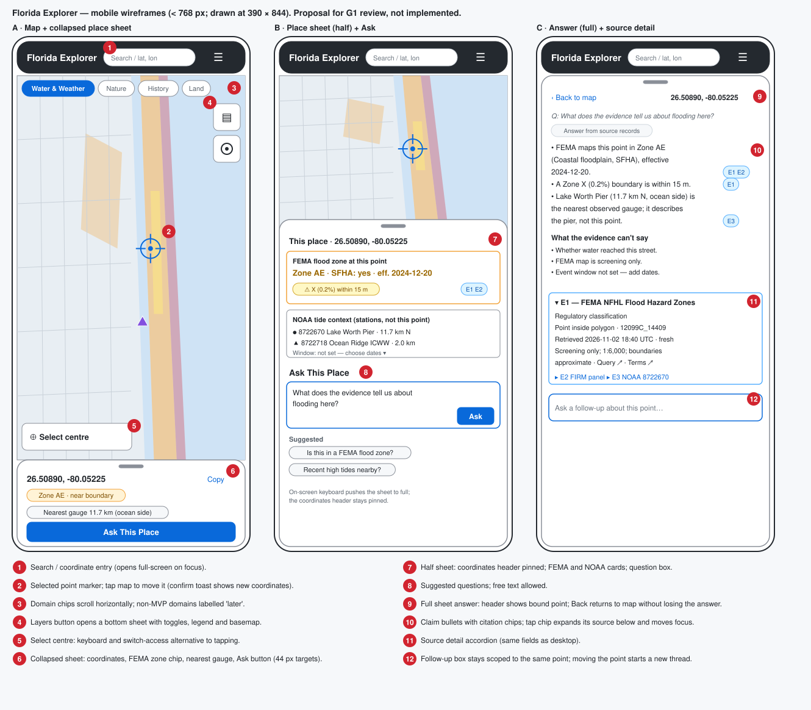

# UI design and interaction specification

Status: UI proposal for Chuck's review before any build (G1). **Implementation and deployment NOT authorized.** There is no application code, no scaffold and no dependencies. The mockups are static images, and all sample content in them is **illustrative**: not live data and not validated answers. Where sample values come from this session's live source checks (Zone AE, panel 12099C0793G, Lake Worth Pier, the three Palm Beach County natural areas), they only show realistic layout.

## 0. Revision 2: visual proposal for a general-public audience

### 0.1 Mockups

**Desktop: Explore this place**

**Desktop: Ask This Place answer with expanded source**

**Desktop: Nature & Wildlife**

**Mobile: explore, answer, map layers, Nature & Wildlife**

### 0.2 Design principles

1. **Place first.** Lead with the place name and one plain sentence. Coordinates sit behind "Show exact location".
2. **Plain language up front, technical detail on request.**
   - Visible by default: plain-language explanations, readable source labels and suggested questions.
   - Behind expanders ("Technical details", "Sources used"): FEMA zone codes, map panels, station IDs, datums, retrieval times and coordinates.
3. **Inviting, not alarming.** Warm palette, generous spacing and a calm map. Risk words are factual ("higher-risk flood area"), with no red alarm styling for regulatory categories.
4. **Uncertainty is visible but compact.** Each answer has one "What this can't tell you" line that expands to the full list of limitations. Caveats don't fill the main screen.
5. **No implied verification.** There are no "verified", "confirmed" or checkmark badges on answers or places. The evidence safeguards (fact-checked claims, coded limitations) work behind the scenes. When the model is unavailable, a plain line says "Short answer from source records (assistant unavailable)".
6. **Honest scope.** Capabilities that aren't integrated are shown as "Coming later" or "Proposed", never as live.

### 0.3 Visual system (proposed)

| Token | Value | Use |
|---|---|---|
| Ink | `#1C2B33` (secondary `#4A5A63`, tertiary `#73828A`) | Text: 4.5:1+ on sand and white |
| Sand | `#F7F3EC` | App background |
| Card | `#FFFFFF`, 14 px radius, 1 px `#EBE7DE` border | Content cards |
| Teal (primary) | `#0D6B78` / dark `#0A5560` / tint `#E3F1F2` | Buttons, links, active tab, suggested questions |
| Sun | `#F2C14E` | Brand mark only |
| Coral | `#E2603F` | Selected-place pin only |
| Flood: higher risk | Blue `#3B5BA5` with diagonal hatch | FEMA 1% annual chance zones (A*, V*); VE darker fill |
| Flood: moderate | Light blue `#8DB5DC` with dots | FEMA X (0.2%) |
| Wetlands | Teal-green `#3F9C86` with wave pattern | NWI |
| Conservation | Green `#7CB46B`, solid outline | Conservation lands |
| Aquatic preserve | Aqua `#1793A8`, dashed outline | FDEP preserves |
| Shoreline | Brown `#6B4F3A` line | NOAA shoreline |

- **Typography (proposed):**
  - Headings: a warm serif (proposed *Fraunces*, 28–30 px desktop, 22–25 px mobile).
  - UI and body: a humanist sans (proposed *Source Sans 3*, 14–15 px body, 12–13 px meta).
  - The mockups render with metric-compatible fallbacks (DejaVu Serif / Liberation Sans) because no fonts were installed.
- **Spacing:** 4 px base (8/12/16/22 px), with 22 px panel padding on desktop and 18 px on mobile.
- **Touch targets:** at least 44 px.
- **Map styling:**
  - Muted land and water basemap so overlays read clearly; light street grid; place labels in dark grey.
  - Every overlay uses colour **plus** pattern or line style, so it survives colour-blindness and print.
  - A compact legend pill shows only the active layers.
  - The selected place is a coral pin with a name label.

### 0.4 Plain-language flood copy (template keyed by the verified FEMA fact)

Plain text is generated from the verified `FLD_ZONE` / `ZONE_SUBTY` fact using an owner-approved table, so the fact-checking safeguards still apply (evidence-and-agent-design.md §4.9–4a). The technical code always appears in "Technical details".

| FEMA fact | Plain-language headline (proposed wording) |
|---|---|
| A, AE, AH, AO, AR, A99 | "FEMA maps this spot in an area with a 1% annual chance of flooding." |
| V, VE | "FEMA maps this spot in a coastal area with a 1% annual chance of flooding, where waves add to the hazard." |
| X with 0.2% subtype | "FEMA maps this spot in an area with a 0.2% annual chance of flooding." |
| X (minimal) | "FEMA maps this spot outside its 1% and 0.2% annual-chance flood areas. Flooding can still happen." |
| D | "FEMA's map shows the flood hazard here as undetermined." |
| `in_coverage_no_zone` | "FEMA's map covers this spot but shows no flood zone here. That's a gap in the map, not a sign of low risk." |
| `outside_nfhl_coverage` | "FEMA's digital flood map doesn't cover this spot." |
| `classified_near_boundary` / `nearbyZones` | adds "FEMA's map shows a different flood zone within 15 m of this spot." (15 m is the verified buffer distance, D8; boundaries on the map are approximate) |

Wording rules:
- The sentence always says what **FEMA maps**. It never claims the property has that probability.
- No "risky", "safe", "low risk" or "a few steps away".
- Distances appear only when computed from source geometry (the boundary buffer, or a distance to a polygon).
- In technical details, "1% annual chance" is explained as FEMA's regulatory definition for the mapped area, not a property-level forecast.

### 0.5 Readable source labels

Citations show a readable label. The evidence ID (`E1`) is kept for audit and appears only in source details.

| Evidence | Label shown |
|---|---|
| FEMA NFHL layers 28/3/0 | "FEMA flood map" |
| NOAA CO-OPS observed water level | "NOAA tide gauge · {station name}" (e.g. "NOAA tide gauge · Lake Worth Pier") |
| NOAA CO-OPS predictions | "NOAA tide forecast · {station name}", e.g. "NOAA tide forecast · Ocean Ridge (Intracoastal)" for 8722718 and "NOAA tide forecast · Lake Worth Pier (ocean)" for 8722670 |
| FDEP/FNAI conservation lands (proposed) | "Florida conservation lands" |
| USFWS NWI (proposed) | "Wetlands inventory" |
| FDEP aquatic preserves (proposed) | "Florida aquatic preserves" |

Station labels are built from the cited record's own station name and water body, never from a fixed string, so predictions from different stations can't be confused. Records are merged under one label only when the label text would be identical, for example the FEMA zone and FIRM panel records ("FEMA flood map"). Records from different stations or features always keep separate labels, so a claim citing Ocean Ridge and Lake Worth Pier predictions shows both.

### 0.6 Explore this place

- Shows the place name (from the geocoder or Census place record), a one-line description and up to three summary cards: Flooding, Tides nearby, Nature nearby (proposed, C8).
- **Ask This Place is always visible.** On desktop it is pinned to the bottom of the place panel: the Ask box plus one row of suggested questions, with a top shadow. Cards scroll above it, and it never scrolls out of view. On mobile it stays in the collapsed and half sheets as the primary button or box. Acceptance: at 1366×768 and 360×800 the Ask box is visible without scrolling (N31).
- Each card has one plain sentence, a source label and one expander.
- Suggested questions sit under the Ask box: "Could this area flood?", "What are king tides?", "What's protected near here?", "How high do tides get?".
- **Gap flagged:** the one-line place description isn't from a current evidence source. Options are U8 (a curated, owner-approved blurb labelled as editorial, a sourced description, or omit it in the MVP). Until decided, the mockup sentence is illustrative only.

### 0.7 Ask This Place

- One question bubble, a short answer in two to four sentences, and readable source labels after each claim.
- One "What this can't tell you" line, then "Sources used (n)" expanding to source cards with technical rows.
- Follow-ups stay bound to the same place, and the header shows the place name with "Answers are about this spot only".

### 0.8 Map layers

- The layer panel is discoverable: a floating card on desktop, a bottom sheet on mobile.
- Layers: **Flooding** (baseline), **Wetlands**, **Conservation areas**, **Aquatic preserves**, **Shoreline** (proposed, C7 — tagged "Proposed" in the mockups) and **Tide stations**.
- Each row shows a swatch, a plain name and a source subtitle. Tapping the name opens "What's this?" with the source, date and limitations.
- Fixed note: "Layers help you look around. What we say about your spot comes from each source's own records."
- **Descriptive controls.** Map controls carry visible text labels, not icons alone: "Map layers", "Select map center", "Zoom in", "Zoom out" and "My location". Icons, where used, sit next to the text, and the accessible name equals the visible label (WCAG 2.5.3). On mobile, the label may be shortened to "Layers" but the accessible name stays "Map layers" (N32).

### 0.9 Nature & Wildlife

- Two explicit concepts:
  - **"Seen here":** a reported sighting at a place and date. It doesn't mean the species lives there.
  - **"Could live here":** mapped likely habitat. It doesn't mean anyone has seen it there.
- Live in the proposal: protected places nearby and wetlands (C7/C8).
- **Actionable nearby-place cards.** Each protected place shows:
  - its name and managing agency;
  - the **distance from the selected spot to the area's boundary**, computed server-side from source geometry ("0 km — this spot is inside" when inside);
  - a **"Show on map"** button that zooms to and highlights the area, with focus moving to the map and an announced name;
  - a link to the manager's website when the source provides one.
  
  A fixed line under the list reads: "Protected doesn't always mean open to the public. Check with the managing agency before visiting."
- Shown as **Coming later:** wildlife sightings (iNaturalist candidate) and likely rare-species habitat (FNAI Biodiversity Matrix, pending data-use permission). Details are in layer-reuse-feasibility.md §4.
- Example content is labelled "Example layout — not live data".

### 0.10 What changed from round 1

The round-1 interaction spec below still applies, with these changes:
- Coordinates, codes and IDs move behind expanders.
- Citation chips show readable labels.
- The "Built from verified evidence" badge is removed.
- The layer list grows (proposed).
- Nature & Wildlife becomes a real tab.

The round-1 structural wireframes are kept for layout and annotation reference. Where they differ, these mockups win on look and content.

## 1. Structural wireframes (round 1 — layout reference)

### Desktop (≥ 1024 px)

Three columns: layers and legend (250 px) · map (flexible) · "This place" panel (≈ 400 px, resizable 360–560 px). The annotations are in the right-hand column of the drawing.

### Mobile (< 768 px)

Full-screen map with a bottom sheet that has three snap points: A collapsed (≈ 150 px), B half (≈ 60% of the screen) and C full. Tablet (768–1023 px): map with the place panel as a right-hand drawer (≈ 380 px), and layers in a popover.

## 2. Layout regions

| Region | Contents | Requirement |
|---|---|---|
| Top bar | Product name; place search or typed lat/lon; four domain tabs; About/Help | R01, charter domains |
| Domain tabs | **Water & Weather** (MVP, active), **Nature & Wildlife**, **History & Change**, **Land & Infrastructure** (labelled "later"; visible so the product scope is legible, but they load no data) | Charter; PRD future domains |
| Layers panel | FEMA flood hazard overlay (toggle, opacity), NOAA station markers, NOAA sea level rise (disabled, "later — D3"), basemap choice, FEMA legend with verbatim codes and plain labels, station legend, an "overlay is orientation only" note, and attribution | R02, R03, R08 |
| Map | Basemap, FEMA overlay, station markers (circle = observed, triangle = predictions only), selected-point crosshair and coordinate chip, zoom, locate, "Select map center" control, scale bar, attribution | R01, R02, R08 |
| This place | Bound-point header; FEMA card; NOAA card; Ask This Place; answer; source details | R02–R06 |

## 3. Interaction specification

### 3.1 Selecting a point (R01, AC01, AC11)

| Input | Behaviour |
|---|---|
| Click or tap on the map | Moves the crosshair to the exact clicked coordinate and shows the chip `26.50890, -80.05225` (5 dp display; full precision is kept). On mobile, a toast "Point moved to …" offers Undo for 5 s |
| Keyboard | Map is focusable. Arrow keys pan by 1/8 of the viewport (Shift: 1/2), `+`/`−` zoom, and **Enter** or the "Select map center" button selects the fixed centre crosshair. The result is identical to a click |
| Typed coordinates | Search box accepts `lat, lon`. Rejected with an inline message and no query when outside the Florida envelope ("This point is outside Florida; Florida Explorer covers Florida only") or when the order looks swapped ("Did you mean 26.51, -80.05? Latitude comes first") |
| Place search | Geocoder suggestions (provider per D1). Choosing one sets the point; the chip shows coordinates, not just the name |
| Copy | Copies coordinates in `lat, lon` decimal degrees |

**One bounds check for every input.** Click, tap, keyboard centre selection, typed coordinates and place search all go through the same Florida-envelope check (the same bounds as the API, technical-design.md / source-feasibility.md rule 5) before the point changes. Out-of-bounds selections don't move the crosshair, don't start a new `selectionId` and send no request. The previous point and its results stay, and the message reads "This point is outside Florida; Florida Explorer covers Florida only". If the API still rejects a point (for example, the bounds drift between client and server), the panel shows that rejection message, not an empty or loading state.

Only one point is active at a time. Area selection is out of scope (PRD future).

### 3.2 Changing the point (R04, AC05)

1. New `selectionId`. All in-flight evidence and answer requests for the old point are aborted.
2. The FEMA and NOAA cards and any answer for the old point are removed immediately and replaced by loading states for the new point. Nothing from the old point remains visible.
3. The Ask thread is closed. A divider reads "Now asking about 26.50870, -80.05170". Previous answers stay available under "Earlier points" (collapsed) with their own coordinates.
4. A response is rendered only if its `selectionId` and `locationEcho` match the current point.

### 3.3 Layer controls (R02, R08)

- Toggles are real checkboxes with labels and opacity sliders (0–100%, step 10).
- Turning the FEMA overlay off does not change the classification card, which comes from the server-side point query.
- The legend shows FEMA codes verbatim (`AE`, `VE`, `X`, …) with short plain labels. Colour is never the only cue: each zone also has a pattern on the map, and the code is always shown in the card.
- Station markers have accessible names, e.g. "8722670 Lake Worth Pier, observed water level, 11.7 km north".

### 3.4 FEMA card (R02, R05, R06)

| State (source-feasibility.md) | Card copy (fixed) | Visual |
|---|---|---|
| `classified` | "Zone AE · Coastal floodplain · SFHA: yes" + BFE/datum + panel + effective date | Zone colour bar |
| `classified_near_boundary` | As above, plus the chip "Near boundary: X (0.2%) within 15 m" | Amber chip |
| `in_coverage_no_zone` | "FEMA's digital map covers this point but returned no flood-zone polygon. This is a data gap, not a finding of low risk." | Grey, dashed border |
| `outside_nfhl_coverage` | "FEMA's digital flood map does not cover this point." | Grey, dashed border |
| either of the two above with `nearbyZones` | adds "FEMA maps Zone AE within 15 m of this point" | Amber chip |
| `ambiguous_overlap` | "FEMA returned more than one zone here: AE, X" | Amber |
| `coverage_unknown` / failure | "FEMA flood data is unavailable right now. Retry" (other sources still shown) | Red outline, Retry button |
| stale cache | Normal content plus "Retrieved <date> (stale)" | Clock icon |
| loading | Skeleton with "Checking FEMA flood map…" | — |

Never shown in any state: "safe", "no risk", "not in a flood zone".

Outside-Florida input is rejected at selection time (§3.1). It never reaches the FEMA card, so it cannot be confused with `outside_nfhl_coverage`.

### 3.5 NOAA card (R03, R05)

- Heading: "NOAA tide context (stations, not this point)".
- One row per station: role (observed or predicted), id, name, water body or side (ocean / Intracoastal), distance and bearing.
- **Window selector:** the date range must be chosen explicitly (start and end date, America/New_York, with the UTC equivalent in the source details). Default is "not set". The UI never interprets relative phrases such as "last week". If a question contains one, the answer asks for dates instead.
- When a window is set: daily max observed and predicted high tides as a small chart and table, each labelled `ft · NAVD88 · EST/EDT · verified/preliminary`. Station thresholds are labelled as the station's thresholds. Datum toggle: MLLW or NAVD88, re-requested from NOAA in that datum (not converted on the client).

### 3.6 Ask This Place (R04, AC04, AC10)

- Question box (multi-line, max 500 characters), Ask button, Enter to submit (Shift+Enter for a new line). There are suggested questions, and free text is allowed.
- Disabled with a reason ("Waiting for evidence for this point…") until the evidence pack exists. If some sources failed, Ask is allowed and the answer is partial.
- In-progress text: "Checking answer against sources…". The answer appears in an `aria-live="polite"` region, and only after validation.
- **Answer layout:**
  - Header with the place name ("Answers are about this spot only"). **No verification badge.** In template mode, a plain line reads "Short answer from source records (assistant unavailable)".
  - Findings as short bullets, each ending in citation chips `E1 E2`.
  - Optional inference bullets in a distinct style, labelled "Inference" with their assumptions.
  - "What the evidence can't say" for unknowns and limitations, using fixed, validated wording.
  - "Sources unavailable" if any source failed.
- Every visible sentence comes from a validated finding, an allow-listed unknown or limitation code, source status or fixed UI copy (evidence-and-agent-design.md §4–4b).
- Follow-ups stay bound to the same point and evidence pack. The header always shows the coordinates.
- Out-of-scope questions (forecasts, insurance, other domains) get a fixed abstention naming what is available and where to look. Questions in the "later" domains get "Nature & Wildlife isn't available yet."

### 3.7 Citations and source details (R05, AC04)

- A citation chip shows a readable source label (§0.5) and is a button. Activating it expands that source in the "Sources" accordion, scrolls to it and moves focus to its heading. Esc or "Back to answer" returns focus to the chip.
- Each source detail shows:
  - Evidence ID, provider and dataset, and evidence class (regulatory classification / measured observation / predicted tide).
  - Spatial relation (point inside polygon / station 11.7 km N).
  - Record IDs, effective date or period, units, datum and time zone.
  - Quality (verified/preliminary), retrieval time (UTC and local) and freshness.
  - Limitations.
  - Links: "View query" (source URL), "Terms" and attribution.
- Hovering or focusing a chip highlights the related map feature or station. This highlight is presentation only.

### 3.8 Partial, stale and failure states (R06, AC06, AC07)

- Each source has its own state and its own Retry. One source failing never blanks the panel.
- Global banner only when every source fails: "Sources are unavailable; nothing can be said about this point right now."
- Stale content stays visible with "Retrieved <date> (stale)". Preliminary NOAA data is labelled "preliminary, may change".

### 3.9 Responsive behaviour (R08, AC09)

| Width | Layout |
|---|---|
| ≥ 1024 px | Three columns (desktop wireframe) |
| 768–1023 px | Map + right drawer (≈ 380 px) for This place; layers in a popover |
| < 768 px | Map + bottom sheet (A/B/C). Selecting a point opens A. Ask opens B. An answer opens C. The coordinates header stays pinned at B and C. When the on-screen keyboard opens, the sheet goes to C |
| 320 px / 200% zoom | Single column, no horizontal scrolling except the map; the domain chips row scrolls |

### 3.10 Accessibility (R08, AC09; thresholds in validation-plan.md)

- Focus order: skip link → search → domain tabs → layers → map → This place (header, FEMA, NOAA, Ask, answer, sources).
- Visible focus ring ≥ 2 px with 3:1 contrast.
- Touch targets ≥ 44 × 44 px on mobile, ≥ 24 × 24 px on desktop.
- Text contrast ≥ 4.5:1, UI ≥ 3:1. Zone colours always come with codes and patterns.
- Live regions: point changes ("Point set to 26.50890, -80.05225") and answer readiness are announced politely. Errors use `role="alert"` only for blocking input errors.
- `prefers-reduced-motion` disables map fly-to animation and sheet easing.
- Map alternative: the This place panel carries all the information, so a screen-reader user can work from typed coordinates without using the map visually.

## 4. Traceability

| UI element | R | AC |
|---|---|---|
| Point selection: click, keyboard, typed; coordinate chip | R01 | AC01, AC09, AC11 |
| FEMA overlay, legend, FEMA card states | R02, R06 | AC02, AC06, AC07 |
| NOAA card, station markers, explicit window | R03, R05 | AC03, AC11 |
| Ask, answer, citation chips, mode badge | R04, R05 | AC04, AC10 |
| Point-change reset and bound header | R04 | AC05 |
| Source details accordion | R05 | AC04 |
| Responsive layouts, keyboard and contrast | R08 | AC09 |

## 5. Open UI decisions (for Chuck)

| ID | Decision | Recommendation |
|---|---|---|
| U1 | Show the three non-MVP domain tabs now ("later") or hide them | Show, disabled. It makes the four-domain product legible without implying data |
| U2 | Place search provider (follows D1 map choice) | Same vendor as the basemap |
| U3 | Default map view | Statewide Florida on first load; no geolocation prompt until the user presses Locate |
| U4 | Earlier-point answers kept in the session | Yes, collapsed, with coordinates; cleared on reload (retention per D6) |
| U5 | NOAA mini-chart in MVP or table only | Table first; chart if time allows (same data) |
| U6 | Brand and visual style | Visual system in §0.3 as the starting point; refine after G2 |
| U7 | Plain-language flood wording (§0.4) | Owner approves the exact wording before I2 |
| U8 | One-line place description in "Explore this place" | Omit in MVP or use owner-approved curated blurbs labelled editorial; never model-generated |
| U9 | Show "Proposed" layers and "Coming later" Nature cards | Show, clearly labelled, so the scope is legible without implying live data |
